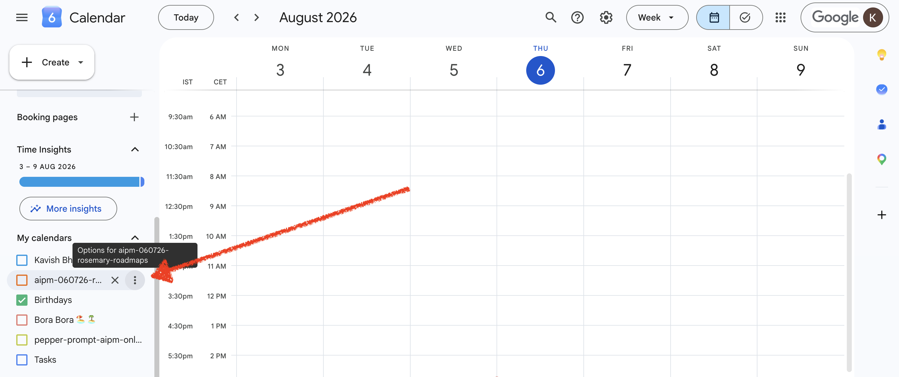
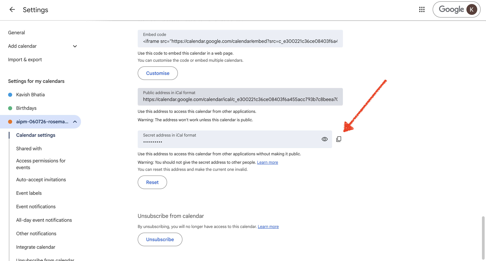
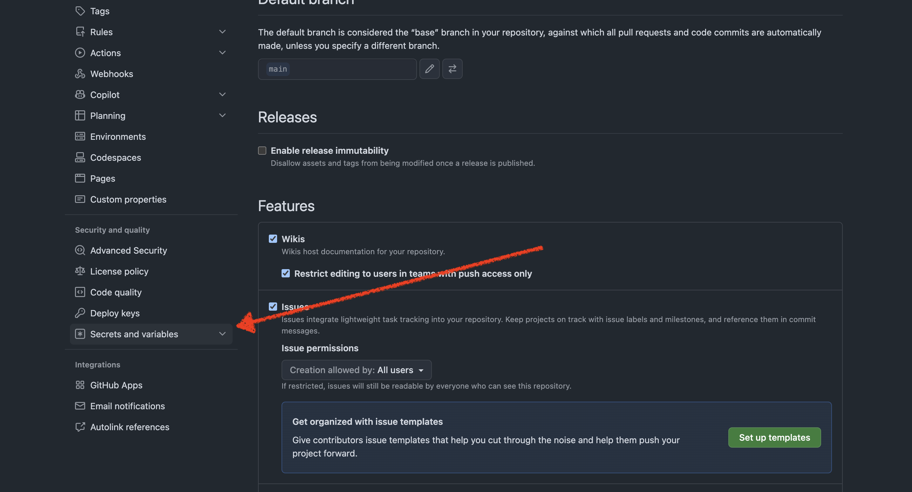
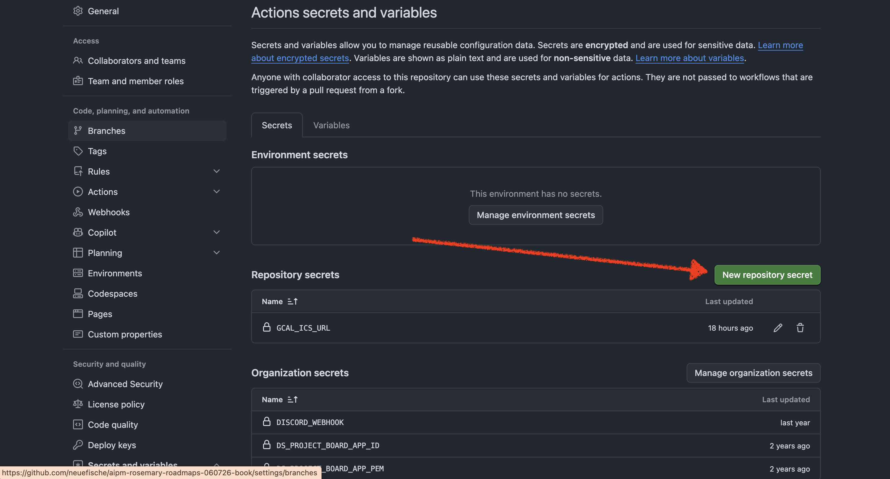
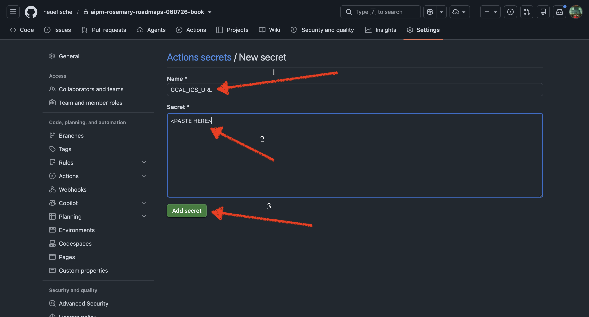
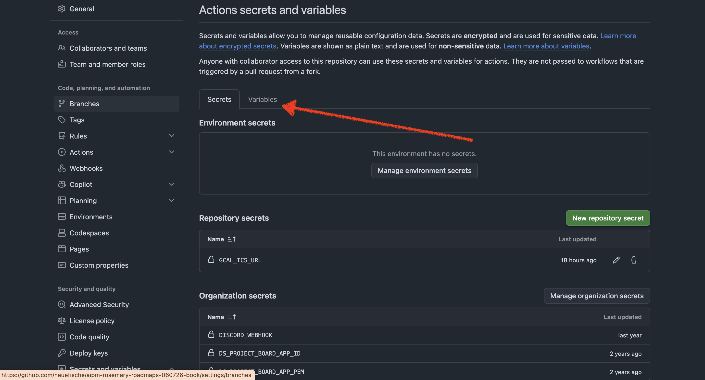
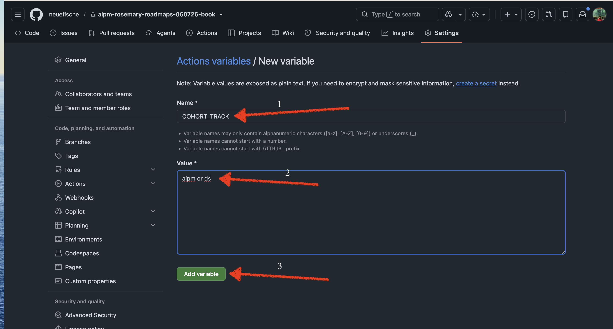

# ToC Automation: Auto-Revealing Session Topics

This can automatically "reveal" (uncomment) the slide deck for the current (next) day's session in [DSBOOK/_toc.yml](DSBOOK/_toc.yml), so students only see a session's slides once it's actually being taught. This is driven by a scheduled GitHub Actions workflow that reads a Google Calendar and edits the table of contents on your behalf.

## How it works, end to end

1. A GitHub Actions workflow ([.github/workflows/reveal-topic.yml](.github/workflows/reveal-topic.yml)) runs on a cron schedule (and can also be triggered manually).
2. It calls a Python script ([.github/scripts/reveal_topic.py](.github/scripts/reveal_topic.py)), which:
   - Fetches the cohort's Google Calendar (as an `.ics` feed).
   - Looks for an all-day event on the **next weekday** (the topic for the upcoming class day).
   - Looks up that event's title in a mapping file ([.github/scripts/topic_mapping.yml](.github/scripts/topic_mapping.yml)) to find the corresponding session file path.
   - Uncomments the matching `- file: <path>` line in `DSBOOK/_toc.yml`.
3. If anything changed, the workflow commits and pushes `DSBOOK/_toc.yml` back to the repo.

## The pieces

### `.github/workflows/reveal-topic.yml`

- **Triggers:**
  - `schedule`: two cron entries, `0 15 * * *` (15:00 UTC) and `0 16 * * *` (16:00 UTC). This covers both German summer time (CEST, UTC+2) and winter time (CET, UTC+1), so one of the two cron firings always lines up with 17:00 Berlin time.
  - `workflow_dispatch`: manual run from the Actions tab, with two inputs — `test_date` (override the date being checked) and `dry_run` (preview only, don't write to `_toc.yml`; defaults to `true`).
- **Steps:** checks out the repo, sets up Python 3.12, installs `.github/scripts/requirements.txt`, runs `reveal_topic.py`, then — only if `dry_run` is not `true` — commits and pushes `DSBOOK/_toc.yml` if it changed.
- **Permissions:** `contents: write`, since the job pushes a commit.

### `.github/scripts/reveal_topic.py`

- **Double-fire guard:** since the schedule has two cron entries, the script checks the real Berlin local time (`is_correct_local_hour`) and only proceeds if it's actually 17:00 there. A cron firing at the "wrong" offset for the current season is a no-op.
- **Target date:** defaults to the next weekday (Mon–Fri), skipping weekends — a Friday evening run targets the following Monday. Can be overridden with the `TARGET_DATE` env var for manual testing.
- **Calendar lookup:** downloads the `.ics` feed from `GCAL_ICS_URL` and pulls out all-day event titles matching the target date (a day can have more than one topic).
- **Topic → file mapping:** looks up each topic's exact title in `topic_mapping.yml`. Entries can be:
  - a plain string (same file for both tracks),
  - a list of strings (multiple files revealed for one topic),
  - a dict with `aipm`/`ds` keys (tracks diverge — resolved via the `COHORT_TRACK` env var).
- **Revealing:** for each resolved file path, it finds the commented `# - file: <path>` line in `DSBOOK/_toc.yml` and strips the leading `#`, preserving indentation.
- **Safety:** topics with no mapping entry, or no path for the current track, are skipped with a log message rather than failing the run.

### `.github/scripts/topic_mapping.yml`

The link between calendar event titles and `_toc.yml` file paths. Key points:

- The calendar event title must match **exactly** (case-sensitive).
- This repo serves both the **AIPM** and **Data Science** tracks; which one is "live" is controlled by the `COHORT_TRACK` repository variable (`aipm` or `ds`).
- Topics with no slide deck at all (career sessions, non-technical activities, etc.) are simply left out of the mapping — the script skips them silently. A commented-out `TODO` block at the bottom of the file tracks known topics that don't have a matching file in `_toc.yml` yet.

### `.github/scripts/requirements.txt`

Python dependencies for the script: `requests` (fetch the calendar), `icalendar` (parse the `.ics` feed), `pyyaml` (read the mapping file).

## One-time setup (per cohort)

The workflow needs two pieces of repo configuration: a **secret** with the calendar URL, and a **variable** with the active track. Screenshots below walk through getting both values and setting them in GitHub.

### 1. Get the calendar's secret iCal address

In Google Calendar, open the settings for the cohort's calendar and select it from the sidebar options menu:

Under that calendar's settings, copy the **Secret address in iCal format** (not the public address — the secret one works without making the calendar public):

### 2. Add it as the `GCAL_ICS_URL` repository secret

In the GitHub repo, go to **Settings → Secrets and variables → Actions**:

Click **New repository secret**:

Name it `GCAL_ICS_URL` and paste the secret iCal address as the value, then **Add secret**:

### 3. Set the `COHORT_TRACK` repository variable

Switch to the **Variables** tab on the same page, click **New repository variable**, name it `COHORT_TRACK`, and set the value to either `aipm` or `ds` depending on which track this repo instance is serving:

Update `COHORT_TRACK` (and `GCAL_ICS_URL`, if the calendar changes) once per new cohort.

## Testing it manually

Use the **Run workflow** button on the `Reveal scheduled topic from calendar` workflow in the Actions tab:

- Leave `test_date` blank to check "the next weekday," or set it to a specific `YYYY-MM-DD` to simulate a given day.
- Leave `dry_run` set to `true` (the default) to see what *would* be revealed in the workflow logs, without touching `_toc.yml`.
- Set `dry_run` to `false` to actually apply and commit the change.

## Maintaining the mapping

When a new session gets added to `_toc.yml`, add a matching entry to `topic_mapping.yml` using the calendar event's exact title as the key. If the topic differs between tracks, use the `aipm`/`ds` dict form; otherwise a plain string (or list, for multiple files) is enough. Topics that intentionally have no slide deck don't need an entry at all.
